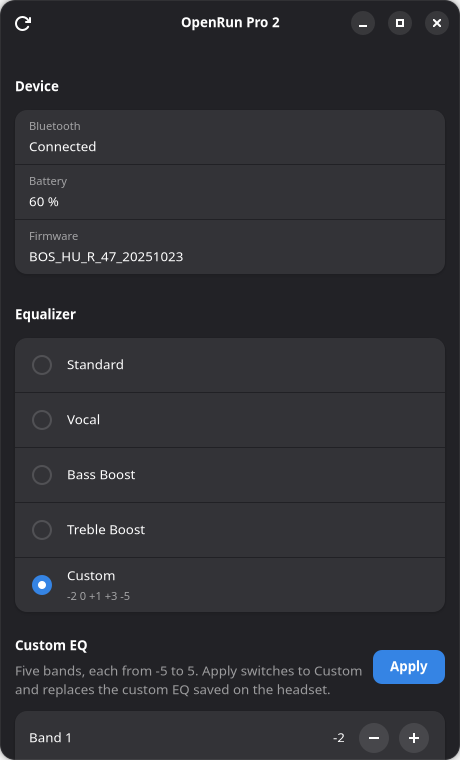

# Shokzer

Settings for the **Shokz OpenRun Pro 2** on Linux: EQ presets, a five-band custom EQ, multipoint, and which of your devices are connected. It does what the phone app does, from a GTK app or the command line.



Every change is confirmed by reading the setting back from the headset, and nothing is ever sent twice. Playback and calls stay with your normal audio setup; Shokzer only changes headset settings.

*Shokzer is a community project, not affiliated with or endorsed by Shokz.*

> **A hobby project, and AI slop.** I built Shokzer for my own headset, and it does what I need, so it isn't under active development. Most of the code was written with an AI assistant, so treat it as AI slop: use it at your own risk, and don't take it too seriously. Issues and pull requests are welcome, but there's no promise of a reply or a fix; I'll get to them when I get to them.

## Install

You need the headset paired and connected in your Bluetooth settings first.

**Fedora 43 and 44:** download the RPM for your release from the [latest release](https://github.com/merkourio/shokzer/releases/latest), then:

```sh
sudo dnf install ./shokzer-*.rpm
```

**Any distribution:** the installer puts Shokzer in your home folder, no sudo needed:

```sh
curl -fsSL https://raw.githubusercontent.com/merkourio/shokzer/main/install.sh | sh
```

It needs Python 3.12 or newer. The app also needs PyGObject 3.50+, GTK 4 and libadwaita 1.4+; if those are missing, the installer sets up the command-line tool and prints the one command that adds them. Remove Shokzer again with `curl -fsSL https://raw.githubusercontent.com/merkourio/shokzer/main/install.sh | sh -s -- --uninstall`.

**With pipx:** `pipx install --system-site-packages git+https://github.com/merkourio/shokzer` (the flag lets the app use your system's GTK bindings).

## Use

Open **Shokzer** from your applications, or use the command line:

```sh
shokzer status                     # battery, firmware and current EQ
shokzer eq set vocal               # standard, classic, vocal, bass or treble
shokzer eq set classic             # bone only
shokzer eq set hybrid              # alias for standard: bone + air conduction
shokzer eq custom -2 0 1 0 3       # five bands from low to high, each -5 to 5
shokzer multipoint status          # multipoint and the headset's remembered devices
shokzer multipoint on|off
shokzer multipoint connect|disconnect ADDRESS
shokzer diagnose                   # what Linux's Bluetooth service knows; sends nothing
```

Add `--json` for machine-readable output. Addresses are hidden unless you pass `--show-identifiers`, so output is safe to share.

## Good to know

- **Close the Shokz phone app first.** The headset accepts one settings connection at a time, so Shokzer can't connect while the app is connected to it.
- **Custom EQ replaces the one saved on the headset.** Write your bands down from the phone app first if you want to keep them.
- **Classic / Hybrid:** Shokz describes Classic as disabling the dedicated air speaker; Standard (Hybrid) uses both driver types. These are mutually exclusive EQ presets, not independent switches or an overlay on your custom EQ. Both modes were acknowledged and read back on the firmware below; acoustic isolation and persistence weren't measured. Start at low volume; Classic can feel more vibratory. Switching back to Hybrid selects Standard, not your previous custom profile. JSON keeps the canonical names `classic` and `standard`.
- **Turning multipoint off** keeps this computer connected and drops your other devices.
- **Firmware:** tested on `BOS_HU_R_47_20251023` (shown as `HU_R_47_20251023` in the phone app). Other firmware versions get every feature too; Shokzer just asks you to [report how it went](https://github.com/merkourio/shokzer/issues/new?template=firmware-report.yml).
- **Other Shokz models** aren't supported yet. Shokzer refuses to send them anything.

## Troubleshooting

| Problem | Fix |
|---|---|
| `br-connection-refused` | The Shokz phone app is connected to the headset. Force-stop it and try again. |
| `br-connection-busy` that doesn't go away | Turn the headset off and on. |
| "The headset isn't connected" | Connect it in your Bluetooth settings; Shokzer never connects or pairs devices itself. |
| Permission denied talking to BlueZ | Some distributions only let members of the `bluetooth` group use BlueZ: `sudo usermod -aG bluetooth $USER`, then log out and in. |
| The app doesn't start | Run `shokzer-gui` in a terminal: it says which GTK piece is missing. |

Found a bug? [Open an issue](https://github.com/merkourio/shokzer/issues/new?template=bug-report.yml) with the output of `shokzer diagnose --json`.

## How it works

Shokzer talks to the headset over its Bluetooth management channel (RFCOMM, service `0xFEF0`), which BlueZ opens on request; it never guesses channels or connects devices. The protocol knowledge comes from [Gadgetbridge](https://codeberg.org/Freeyourgadget/Gadgetbridge) and was checked against a real headset, with two corrections: replies can be fragmented, and the multipoint off value is now known. Details, sources and evidence are in [docs/protocol-analysis.md](docs/protocol-analysis.md) and [docs/test-results.md](docs/test-results.md).

## Contributing

See [CONTRIBUTING.md](CONTRIBUTING.md). Firmware reports are the most useful contribution, though replies may take a while. Please follow the [code of conduct](CODE_OF_CONDUCT.md), and report security problems privately as described in [SECURITY.md](SECURITY.md).

## License

AGPL-3.0-or-later. The protocol implementation is derived from Gadgetbridge (AGPL-3.0-or-later); see [NOTICE](NOTICE) and [docs/licensing.md](docs/licensing.md).

## Support

If you find Shokzer useful, you can [buy me a coffee on Ko-fi](https://ko-fi.com/merkourio). Tips are optional and support my side projects.
